# 3D Scene and Object Reconstruction Using Structure from Motion and Deep Learning

## Final results

This document collects the results of every stage in the project plan and the four experiments it asks for. Every number below comes from a file under `outputs/`, and every figure can be regenerated with `python -m experiments.run_all`.

## 1. Summary

The system takes a handheld phone video, reconstructs the scene and the camera path with Structure from Motion (SfM), finds an object in the frames with YOLO, lifts it into 3D, and classifies 3D shapes with PointNet.

| Plan stage | Status | Main result |
|---|---|---|
| 1. Video and preprocessing | Done | 9.6 s video (572 frames, 1080×1920) reduced to 47 sharp, non-duplicate keyframes |
| 2. Structure from Motion | Done, two engines | Own OpenCV pipeline: 32 of 47 cameras, 2,077 points. COLMAP: 47 of 47 cameras, 4,853 points, 0.79 px error |
| 3. Object detection | Done | Bottle segmented in 40 of 47 keyframes (85%) |
| 4. Object-level 3D | Done | 29 object points, 3D bounding box, 84% of points stay on the object in unseen views (COLMAP) |
| 5. Visualisation and recognition | Done | Scene, trajectory and box figures, interactive 3D view, dashboard. PointNet: 84.6% on ModelNet40 |
| Four report experiments | Done | Sections 4 to 7 |
| Ten object videos | Done | All 10 reconstructed; a 3D object cloud and box for 9; 92% of object points stay on the object in unseen views (section 8) |

The project was developed on one video of a bottle (sections 2 to 7) and then run on ten further object videos, with COLMAP as the SfM engine (section 8).

Four findings matter most when presenting:

1. **COLMAP reconstructs the whole video; the project's own SfM does not.** COLMAP registers all 47 keyframes. The own pipeline registers 12 to 21 in ten repeated runs and reached 32 only in the stored run.
2. **The assumed focal length was too short.** The own pipeline assumed 1,300 px. COLMAP's self-calibration gives 1,637 px, and stays within 1,638 to 1,658 px for every run with 24 or more frames.
3. **PointNet recognises clean shapes but not SfM point clouds.** It scores 84.6% on ModelNet40 and labels the fitted bottle model correctly, but it classifies none of the reconstructed real objects correctly, even those with thousands of points.
4. **The geometric pipeline generalises across objects.** On ten different videos, every scene was reconstructed, and the object was separated and boxed in 3D for nine of them.

## 2. Input data

| Item | Value |
|---|---|
| Video | `data/raw_videos/Vdo.mp4`, 9.6 s, 572 frames at 59.6 fps, 1080×1920 portrait |
| Scene | One bottle on a desk, with books, a shelf and a wall socket behind it |
| Keyframes | 47, selected by blur, brightness and near-duplicate filtering |
| Camera calibration | None. No checkerboard images were captured, so intrinsics are estimated |
| Camera motion | A side-to-side sweep in front of the bottle, not a full orbit |

The bottle is opaque, matte grey-green, with a black strap at the neck. Its body has almost no texture, which is why very few feature points are found on it.

## 3. Structure from Motion

### 3.1 Own pipeline (OpenCV)

The project implements the full chain itself: SIFT or ORB features, ratio-test matching, essential-matrix RANSAC, pose recovery, triangulation, PnP registration of further cameras, and bundle adjustment.

The stored main reconstruction (`outputs/real_video_sfm/focal_1300/`) has 32 registered cameras (keyframes 0 to 31), 2,077 sparse points, a median reprojection error of 1.03 px and a mean of 3.12 px. The mean is pulled up by a small number of gross outliers (maximum 888 px).

### 3.2 COLMAP baseline

COLMAP was run on the same 47 keyframes through `pycolmap` on the CPU, with one shared camera whose focal length and radial distortion it estimates.

| Engine | Registered cameras | 3D points | Mean reprojection error | Mean track length | Focal length |
|---|---|---|---|---|---|
| Own incremental SfM (stored run) | 32 of 47 | 2,077 | 3.12 px | 3.41 views | 1,300 px (assumed) |
| COLMAP | 47 of 47 | 4,853 | 0.79 px | 5.29 views | 1,637 px (self-calibrated) |

COLMAP took 57 s in total (17 s features, 21 s matching, 19 s mapping).

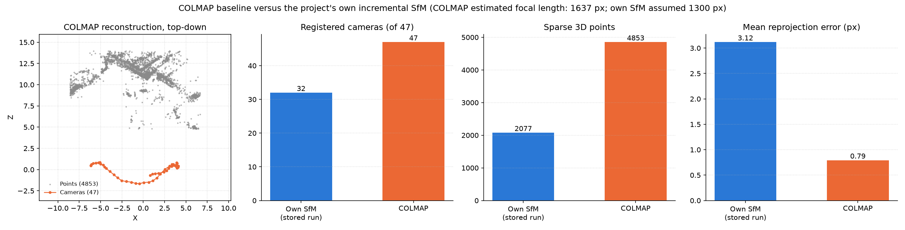

The earlier focal-length comparison in this project tested 935, 1,300 and 1,663 px and chose 1,300 px because it registered the most cameras. COLMAP's estimate of 1,637 px is close to the 1,663 px candidate instead.

## 4. Experiment 1: SIFT versus ORB

Both detectors were limited to 2,000 features per image and run on all 46 consecutive keyframe pairs. Matches were filtered with Lowe's ratio test (0.75) and verified with essential-matrix RANSAC.

| Metric (mean per pair) | SIFT | ORB |
|---|---|---|
| Keypoints per image | 702 | 1,622 |
| Matches after ratio test | 219 | 486 |
| RANSAC inliers | 155 | 351 |
| Inlier ratio | 68% | 71% |
| Extraction time per image | 277 ms | 34 ms |
| Matching time per pair | 25 ms | 18 ms |

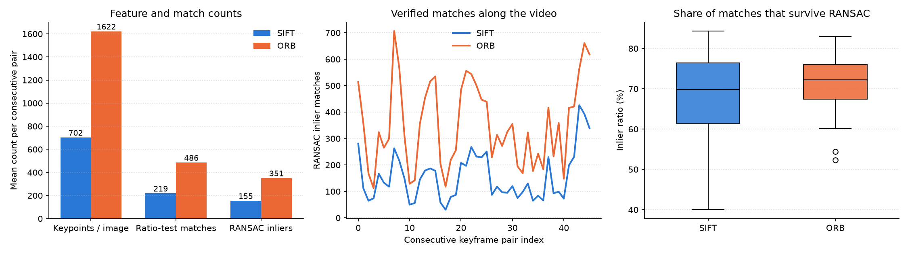

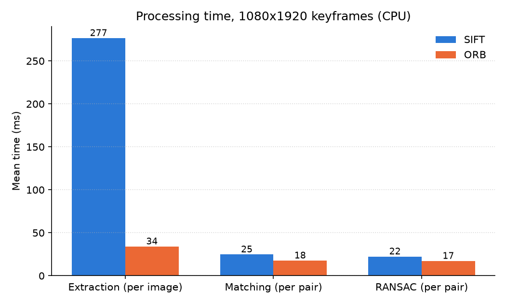

ORB finds more than twice as many verified matches and extracts features about eight times faster. SIFT returns far fewer keypoints than the 2,000 allowed because its contrast threshold rejects weak features in this low-texture scene.

Running the whole own-SfM pipeline with each detector, five random seeds each:

| Full pipeline (47 keyframes) | SIFT | ORB |
|---|---|---|
| Registered cameras, median (min to max) | 13 (12 to 21) | 13 (13 to 13) |
| 3D points, median (min to max) | 611 (539 to 1,350) | 741 (741 to 741) |
| Median reprojection error | 0.92 px | 1.01 px |
| Runtime | 25.5 s | 16.5 s |

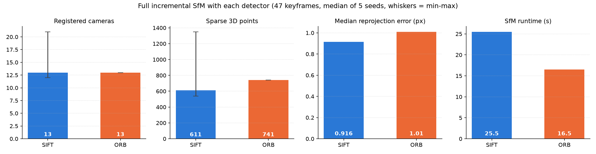

More pairwise matches did not give a larger reconstruction: both detectors stop at about 13 cameras. ORB gives the same result on every seed, while SIFT varies. The likely reason is that SIFT descriptors are matched with FLANN's randomised approximate search and ORB with exact brute-force matching.

Example verified matches for one pair: [SIFT](../outputs/experiments/exp1_feature_matching/matches_sift_pair_23_24.jpg), [ORB](../outputs/experiments/exp1_feature_matching/matches_orb_pair_23_24.jpg).

## 5. Experiment 2: reconstruction versus number of frames

N keyframes were sampled uniformly from the 47, so every run covers the same camera sweep at a different density.

| Frames | COLMAP cameras | COLMAP points | COLMAP error | Own SfM cameras, median (min to max) | Own SfM points, median |
|---|---|---|---|---|---|
| 8 | 6 | 175 | 0.72 px | 2 (2 to 2) | 68 |
| 12 | 3 | 167 | 0.40 px | 3 (2 to 3) | 82 |
| 16 | 12 | 630 | 0.70 px | 2 (2 to 3) | 34 |
| 24 | 19 | 1,643 | 0.69 px | 6 (2 to 7) | 481 |
| 32 | 24 | 2,589 | 0.71 px | 10 (2 to 14) | 702 |
| 40 | 40 | 3,965 | 0.76 px | 25 (9 to 26) | 1,553 |
| 47 | 47 | 4,888 | 0.79 px | 13 (12 to 21) | 616 |

Own SfM was run with 3 seeds per frame count and 10 seeds at 47 frames. COLMAP was run once per frame count.

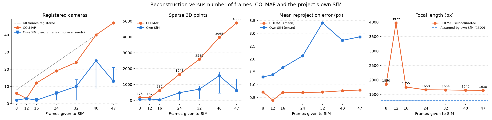

- With COLMAP, points grow almost linearly with frames, and all frames register once 40 or more are used. Below 16 frames the gaps between views are too large and the reconstruction collapses. The focal estimate is also unreliable there (3,972 px at 12 frames).
- The own pipeline never registers all frames at any density.

### Run-to-run stability of the own pipeline

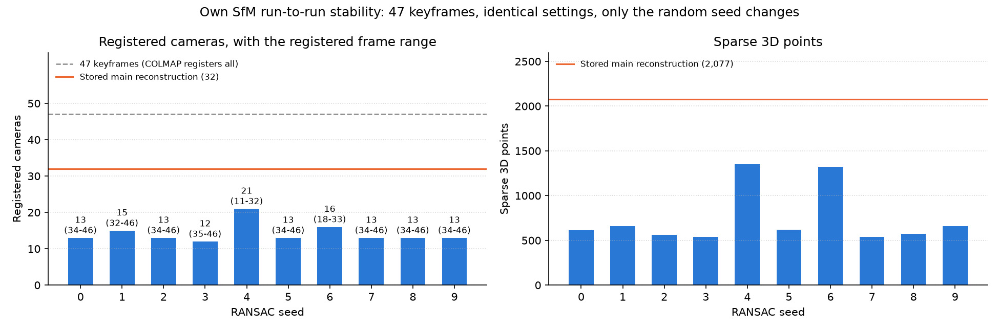

With identical input and settings, ten runs registered 12 to 21 cameras. Seven of them reconstructed only keyframes 34 to 46. The reconstruction breaks at weak links near keyframes 17/18 and 32/33, where a camera is rejected for having 14 PnP inliers against a threshold of 15. Which part of the video survives depends on which seed pair the random draws select. The stored 32-camera run was not reproduced in these ten runs.

## 6. Object detection and object-level 3D

### 6.1 2D detection

A pretrained YOLO segmentation model was run on all 47 keyframes. The bottle was segmented in 40 (85%), with a mean confidence of 0.42. The label is unstable: the same bottle is called `vase` in 22 frames, `bottle` in 13 and `cup` in 5. Seven frames have no detection above the confidence threshold.

### 6.2 Object points and 3D bounding box

A 3D point is assigned to the object when its image observations fall inside the segmentation mask.

| | Own SfM | COLMAP |
|---|---|---|
| Scene points | 2,077 | 4,853 |
| Object points | 29 validated (of 47 candidates) | 29 |
| Oriented box extent (arbitrary units) | 2.40 × 2.05 × 1.34 | 1.61 × 1.16 × 0.96 |

In both reconstructions the object points lie on the cap and the black strap. They span a median 17% of the bottle's height in the image, so the measured 3D box covers the top of the bottle only. The body contributes no points because it has no texture.


The green box is the box of the fitted bottle model described in section 6.4. An interactive version is in `outputs/objects_3d/scene_interactive.html`.

### 6.3 Experiment 3: localisation consistency across frames

The object's 3D points were re-projected into views and checked against the segmentation mask. The baseline is the share of all scene points that fall inside the mask.

| | Views | Object points inside mask, mean | Minimum | Baseline (all scene points) |
|---|---|---|---|---|
| Own SfM, all masked views | 28 | 65% | 0% | 19% |
| COLMAP, held-out views only | 18 | 84% | 25% | 16% |

For COLMAP the test is stricter: points were selected using even-numbered keyframes and evaluated on odd-numbered ones that played no part in the selection.

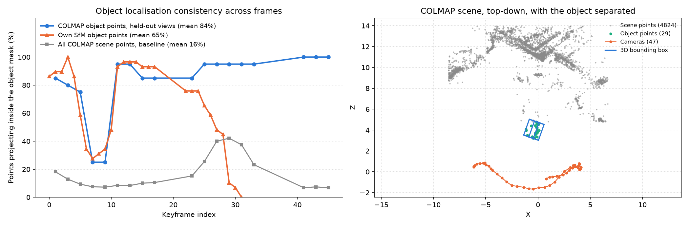

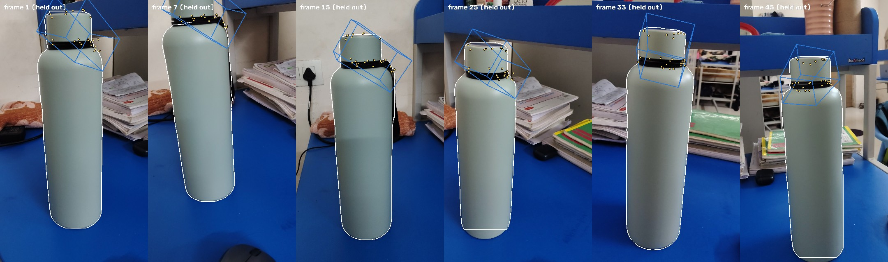

- With COLMAP the points stay on the cap and strap through the whole video, including keyframes 33 to 45 that the own pipeline never registered.
- With the own SfM the points sit on the bottle in the early views but slide off it from camera 25 onwards, reaching 0% in camera 31. This points to pose drift at the end of the registered range.
- Both curves dip at keyframes 7 to 9, where the top of the bottle leaves the image and the mask no longer covers the cap.

Own-SfM detail: 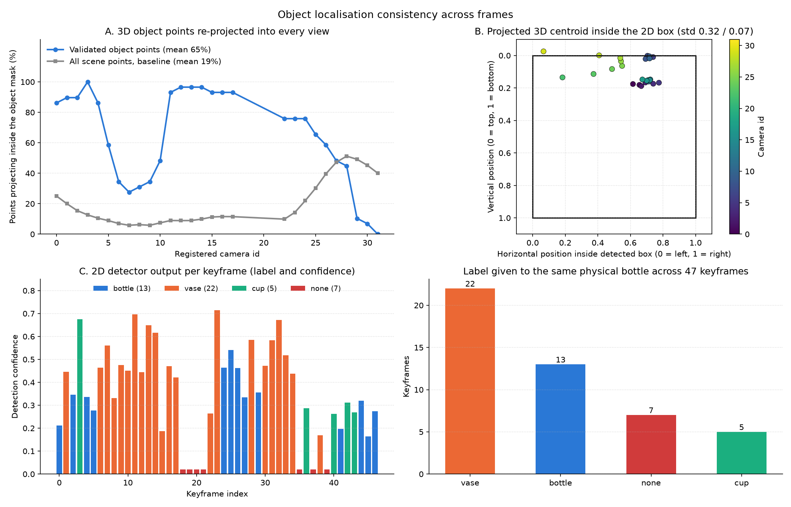

### 6.4 Fitted bottle model

Because the body has no points, an earlier phase fitted an idealised bottle shape (a surface of revolution) to the silhouettes. It is a watertight mesh of 2,162 vertices that overlaps the masks with a mean IoU of 56.6% over 28 views. Its height and radius are fitted; its profile below the cap is an assumed bottle shape, not a measurement. Details are in `outputs/object_reconstruction/` and `outputs/final_evaluation/`.

## 7. Experiment 4: 3D recognition with PointNet

### 7.1 Training

PointNet (with input and feature transform networks) was trained on ModelNet40: 9,840 training shapes, 2,468 test shapes, 40 classes, 1,024 points per shape. Training ran for 40 epochs on a Google Colab GPU in 13.6 minutes with rotation, scale, shift and jitter augmentation. The final-epoch weights are used; the test set was not used to choose a checkpoint.

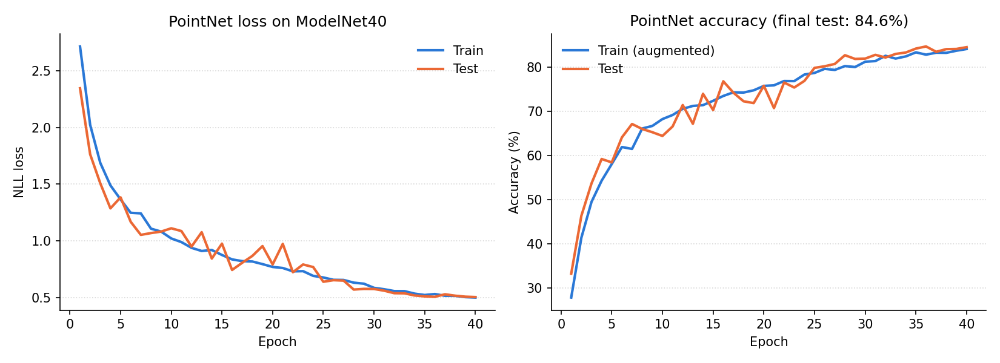

### 7.2 Accuracy

| Metric | Value |
|---|---|
| Overall test accuracy | 84.6% |
| Class-average accuracy | 79.2% |
| `bottle` class | 94% |
| Weakest classes | `flower_pot` 5%, `wardrobe` 30%, `curtain` 50% |

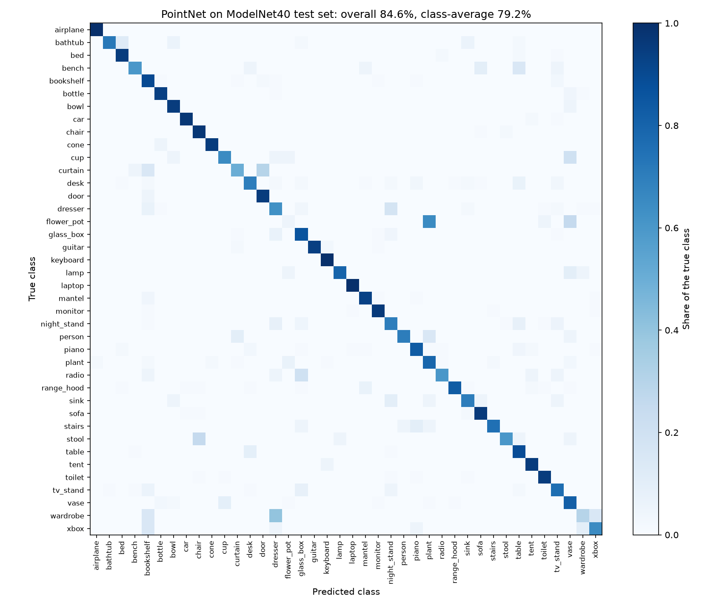

Per-class figures: [per_class_accuracy.png](../outputs/experiments/exp4_pointnet/per_class_accuracy.png). The published PointNet reaches about 89% with longer training; the curve here was still rising at epoch 40.

### 7.3 Noise robustness

The trained network was tested, without retraining, on corrupted versions of the test set.

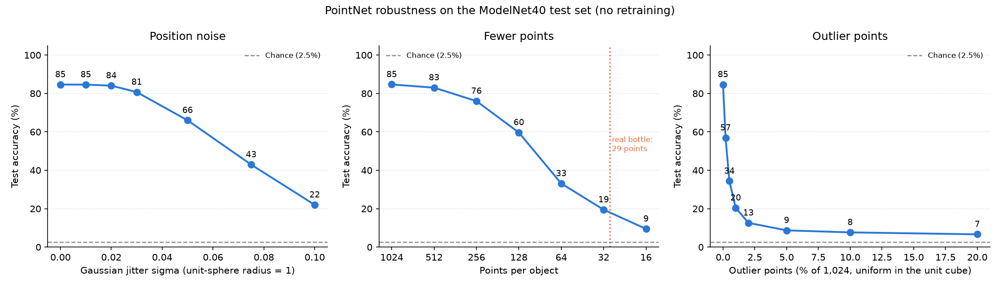

| Gaussian jitter (sigma) | 0 | 0.01 | 0.02 | 0.03 | 0.05 | 0.075 | 0.10 |
|---|---|---|---|---|---|---|---|
| Accuracy | 84.6% | 84.6% | 84.1% | 80.7% | 66.0% | 42.9% | 22.0% |

| Points per object | 1,024 | 512 | 256 | 128 | 64 | 32 | 16 |
|---|---|---|---|---|---|---|---|
| Accuracy | 84.7% | 83.0% | 76.0% | 59.6% | 33.1% | 19.5% | 9.5% |

| Outlier points | 0% | 0.2% | 0.5% | 1% | 2% | 5% | 10% |
|---|---|---|---|---|---|---|---|
| Accuracy | 84.6% | 56.9% | 34.4% | 20.4% | 12.6% | 8.7% | 7.7% |

- The network tolerates small position noise (up to sigma 0.02) and halving the point count.
- It is very sensitive to outliers: two stray points out of 1,024 cut accuracy to 57%. PointNet's global max-pooling lets a single extreme point change the shape descriptor.
- At about 32 points, the size of the real object cloud, accuracy on clean CAD shapes is already down to 19.5%.

### 7.4 The real bottle

| Input | Prediction | Correct |
|---|---|---|
| 29 validated SfM points | `person` (40%) | No |
| All 47 candidate SfM points | `lamp` (84%) | No |
| 2,048 points sampled on the fitted bottle mesh | `bottle` (99.6%) | Yes |

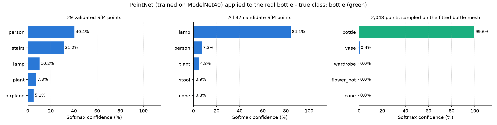

The sparse-point predictions are not stable: the pipeline's own `classify_3d` phase, which applies no orientation correction and random jitter, returned `plant` (57%) on the same 47 points. The correct result on the mesh shows that the network recognises a bottle shape, but that mesh is itself an assumed bottle profile, so this is not independent evidence about the real object. This matches the plan's expectation that recognition on SfM clouds is experimental.

## 8. Evaluation on ten object videos

The pipeline was run on ten short object-centric videos (Objectron clips, 4.8 to 12.3 s each, 1440×1920) covering nine categories. Forty keyframes were taken per video (the sharpest frame in each of 40 equal time windows) and resized to 960×1280. Each video then went through COLMAP, YOLO segmentation, mask-based 2D-to-3D association, a 3D bounding box, the held-out consistency check of section 6.3, and PointNet.

The target mask in each frame is the instance whose label matches the video's category when COCO has that category. For categories that COCO lacks (camera, shoe, cereal box), the most central instance of any class is used.

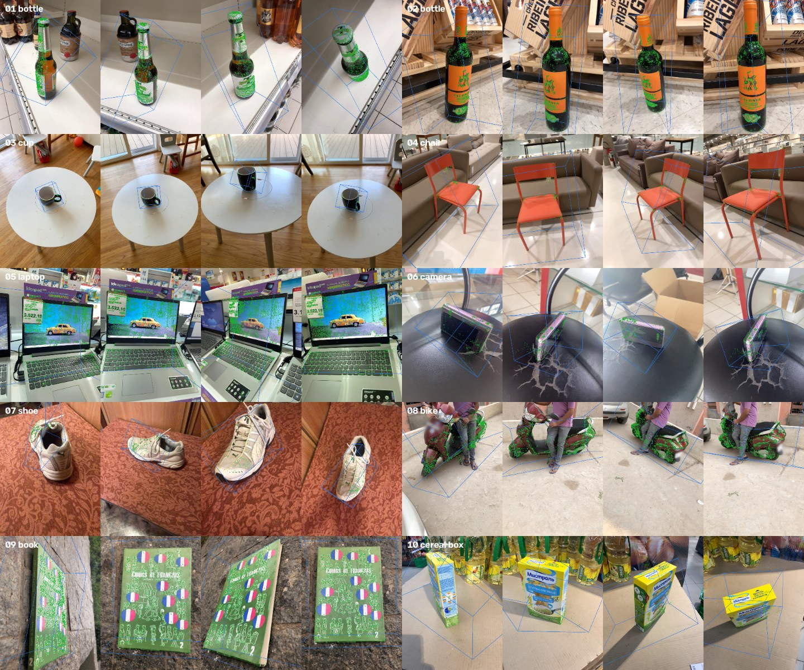

Each row of four images shows held-out keyframes of one video: the white outline is the YOLO mask, the dots are the object's 3D points re-projected, and the blue wireframe is its 3D bounding box.

| Video | COLMAP cameras | Scene points | Reprojection error | Own SfM cameras | Frames with a mask | Object points | Object points inside mask, held-out views | Baseline |
|---|---|---|---|---|---|---|---|---|
| 01 bottle | 40 of 40 | 7,944 | 0.58 px | 40 | 100% | 3,817 | 96% | 51% |
| 02 bottle | 40 of 40 | 13,769 | 0.66 px | 40 | 100% | 3,158 | 99% | 33% |
| 03 cup | 40 of 40 | 6,921 | 0.63 px | 40 | 100% | 77 | 92% | 2% |
| 04 chair | 40 of 40 | 2,369 | 0.93 px | 2 | 100% | 354 | 83% | 26% |
| 05 laptop | 40 of 40 | 20,698 | 0.58 px | 40 | 100% | 8,580 | 84% | 52% |
| 06 camera | 40 of 40 | 4,623 | 0.71 px | 32 | 98% | 869 | 94% | 27% |
| 07 shoe | 40 of 40 | 33,671 | 0.58 px | 40 | 43% | 344 | 100% | 10% |
| 08 bike | 40 of 40 | 29,984 | 0.47 px | 40 | 100% | 3,382 | 85% | 14% |
| 09 book | 40 of 40 | 42,341 | 0.45 px | 40 | 58% | 6,196 | 99% | 31% |
| 10 cereal box | 40 of 40 | 17,906 | 0.49 px | 40 | 3% | 0 | not available | not available |
| **Mean** | **100%** | **18,023** | **0.61 px** | **88.5%** | **80%** | | **92%** | **27%** |

The baseline is the share of all scene points that fall inside the mask in the same views. Own SfM was run once per video, using COLMAP's focal length.

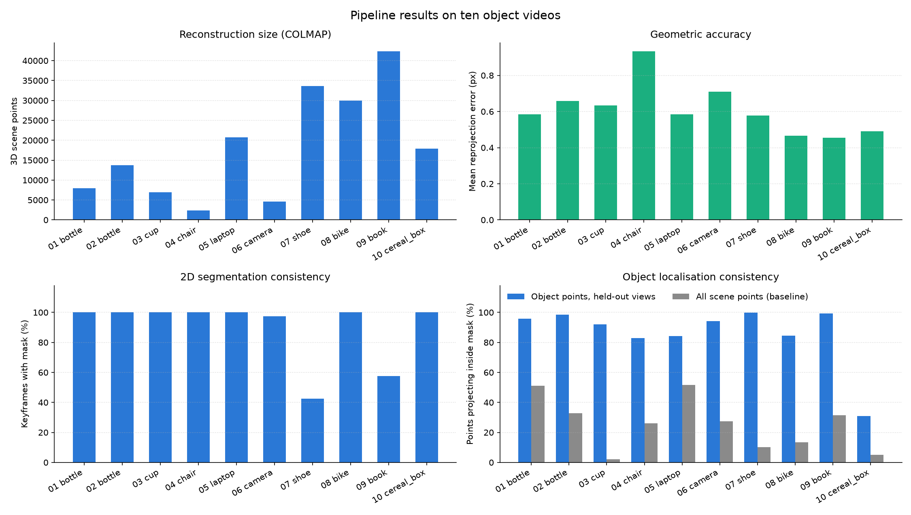

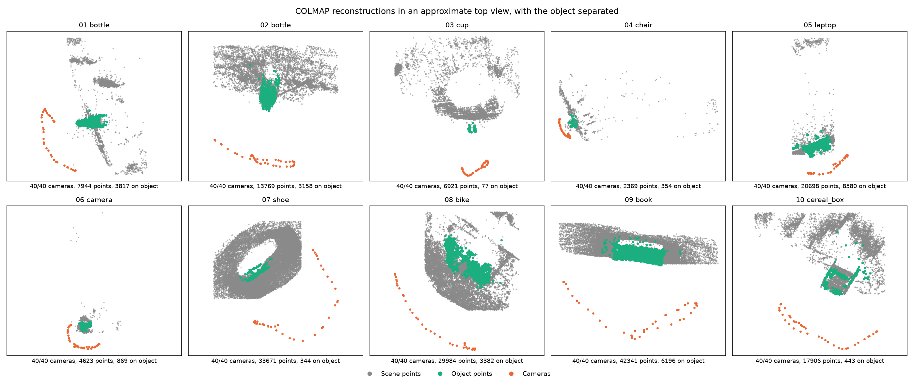

What the ten videos show:

- **Reconstruction works on every video.** COLMAP registers all 40 keyframes each time, with a mean reprojection error of 0.61 px. Its focal estimates agree across videos (973 to 1,070 px at this resolution).
- **The project's own SfM does well on textured scenes.** It registers all 40 keyframes in eight of the ten videos. It fails on the chair (2 of 40), whose scene is glossy floor and plain furniture, and loses part of the camera video (32 of 40).
- **Object clouds are dense when the object has texture.** Printed labels, a keyboard or a book cover give thousands of object points that span the whole silhouette (96 to 100% of its height for seven objects). The plain cup gives 77. This confirms that the 29 points on the original bottle are a property of that textureless object, not of the method.
- **Localisation is consistent.** Across the nine objects with a cloud, 83 to 100% of object points land inside the mask in views that were not used to select them, against a 2 to 52% baseline.
- **2D segmentation is the weakest stage for categories outside COCO.** The five categories COCO contains are found in every frame with the right label (the chair is called `couch` in 3 of 40). The "bike" video shows a motor scooter and is labelled `motorcycle` throughout. The camera is found but called `cell phone` or `suitcase`. The shoe (43%) and book (58%, mostly as `surfboard`) are found in only part of the frames, and the cereal box in one frame of 40, so it gets no object cloud.
- **3D boxes are loose for some objects.** The box is a PCA fit to the object points, so a few stray points from mask leakage enlarge it (visible on the first bottle and the chair).

### PointNet on the reconstructed objects

Five of the ten categories exist in ModelNet40 and have an object cloud (two bottles, cup, chair, laptop).

| Video | Object points | PointNet prediction | Correct |
|---|---|---|---|
| 01 bottle | 3,817 | `stairs` (96%) | No |
| 02 bottle | 3,158 | `stairs` (98%) | No |
| 03 cup | 77 | `stairs` (72%) | No |
| 04 chair | 354 | `person` (61%) | No |
| 05 laptop | 8,580 | `person` (51%) | No |

PointNet is correct on 0 of 5. As a check, the up direction was re-estimated from a fitted support plane and statistical outlier removal was applied before classification; this made the laptop correct and left the other four wrong (1 of 5). Point count is therefore not the limiting factor. SfM clouds cover only the sides the camera saw, follow surface texture instead of sampling the surface evenly, and contain stray points, and section 7.3 shows that PointNet trained on clean CAD shapes is fragile to exactly these differences. Closing this gap would need training on partial, noisy clouds.

## 9. Limitations

- **One object per video.** The plan describes a single room with several objects. The evaluation instead covers eleven videos with one object each, so several objects are never separated within one scene, and the videos are shorter than the planned 15 to 30 s.
- **Target selection uses the video's category.** In the ten-video run the object's category is taken from the file name to choose among YOLO's detections.
- **No camera calibration.** Intrinsics are estimated. COLMAP's self-calibrated value (1,637 px) should replace the assumed 1,300 px in any further work.
- **No metric scale.** No ArUco marker or known length is in the video, so all 3D dimensions are in arbitrary units. The centimetre values in `outputs/metric_scale/` use a default scale of 1.0 and are not measurements.
- **Limited viewing angle.** The camera sweeps across the front of the bottle. The back was never seen.
- **Object cloud is sparse on the original bottle.** 29 points on the cap and strap. The plan anticipates this and asks for the result to be described as object-level sparse localisation, not a complete model.
- **Own SfM is not repeatable.** See section 5.
- **PyTorch3D is not used.** The plan lists it for visualisation; Open3D, Matplotlib and Plotly are used instead.

### Corrections to earlier phase reports

Some of the phase reports under `outputs/` were written before these checks and contain statements that the data does not support:

- They describe the object as a transparent water bottle and attribute the sparse points to refraction. The keyframes show an opaque matte bottle. The cause of the sparse points is the lack of surface texture.
- The Phase 5.6 report states a mean reprojection error below 1.3 px. The reconstruction report for that run gives a mean of 3.12 px and a median of 1.03 px.
- The stored `preprocessing_report.json` and `detection/detection_summary.json` describe an earlier synthetic test clip, not the real video. The real-video equivalents are in `outputs/real_video_validation/` and `outputs/object_segmentation/`.

## 10. How to reproduce

```powershell
.\venv\Scripts\Activate.ps1
python -m pytest tests -q                    # 212 tests
python -m experiments.run_all                # all experiments and figures, about 40 minutes
python -m experiments.run_all --train        # also retrain PointNet (GPU recommended)
streamlit run app.py                         # interactive dashboard
```

| Result | Script | Output folder |
|---|---|---|
| SIFT versus ORB | `experiments/exp1_feature_matching.py` | `outputs/experiments/exp1_feature_matching/` |
| Frame count and stability | `experiments/exp2_frame_count.py`, `exp2b_colmap_frame_count.py` | `outputs/experiments/exp2_frame_count/` |
| Localisation consistency | `experiments/exp3_object_localization.py`, `exp6_colmap_object.py` | `outputs/experiments/exp3_object_localization/`, `outputs/colmap/object/` |
| PointNet | `experiments/train_pointnet.py`, `exp4_pointnet_eval.py` | `outputs/experiments/pointnet/`, `outputs/experiments/exp4_pointnet/` |
| COLMAP baseline | `experiments/exp5_colmap_baseline.py` | `outputs/colmap/` |
| Object cloud, boxes, scene | `experiments/build_object_scene.py` | `outputs/objects_3d/` |
| Ten object videos | `experiments/objectron_batch.py` | `outputs/objectron/` (one folder per video plus summary files) |

The own-SfM and COLMAP numbers change slightly between runs because both use random sampling.
