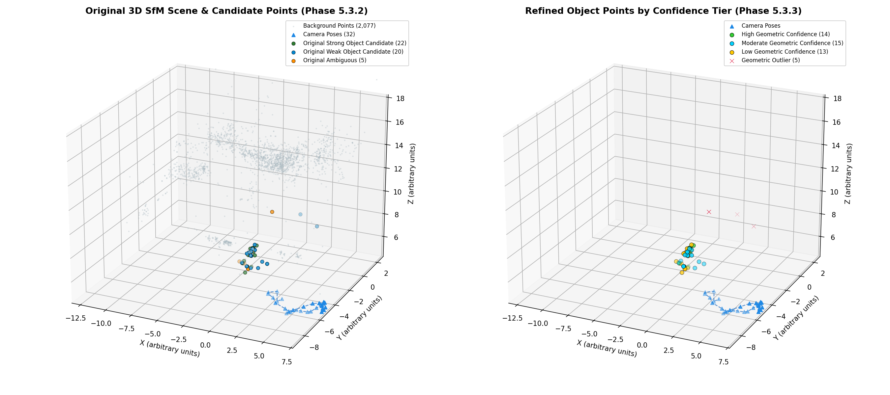
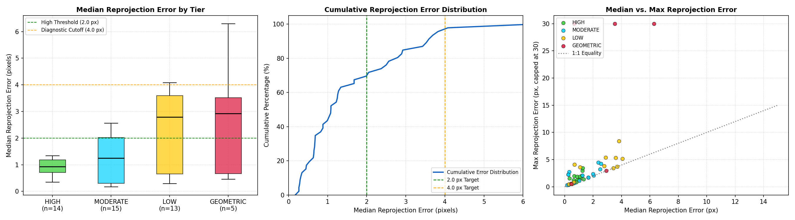
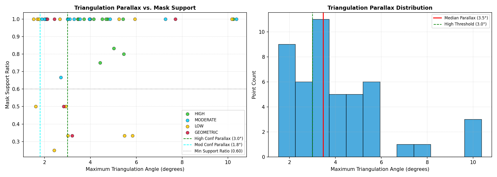
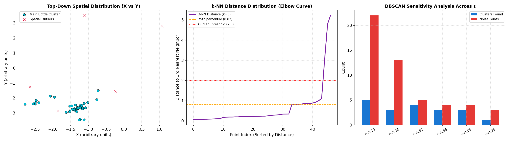

# Phase 5.3.3 Engineering Report: Object-Specific Sparse Point Cloud Refinement

**Project**: 3D Scene and Object Reconstruction Using Structure from Motion and Deep Learning  
**Target Video**: `VID_20261102_015654418.mp4` (Handheld smartphone, $1080 \times 1920$ portrait)  
**Target Object**: Tabletop water bottle / container  
**Primary SfM Reference**: `outputs/real_video_sfm/focal_1300/` (32 registered cameras, 2,077 sparse points)  
**Object Association Reference**: `outputs/object_association/` (47 candidate points: 22 Strong, 20 Weak, 5 Ambiguous)  
**Output Directory**: `outputs/object_refinement/`  
**Date**: November 2026  
**Status**: COMPLETE (126/126 Unit Tests Passing, 100%)

---

## Executive Summary

Phase 5.3.3 establishes a multi-criteria geometric refinement pipeline for the 47 sparse 3D candidate points associated with the tabletop water bottle from Phase 5.3.2. 

While 2D instance segmentation masks delineate silhouette occupancy, silhouette membership alone does not guarantee physical surface ownership or geometric stability. The target container is translucent, refractive, and exhibits specular highlights, causing feature tracks to encompass physical bottle surface markings, cap ridges, internal water refraction, and background features visible through the liquid.

To isolate geometrically reliable object points, this phase evaluated:
1. **Robust Reprojection Statistics**: Median, standard deviation, P90, P95, and maximum error per point; identification of individual observation outliers without discarding valid observations.
2. **Triangulation Geometry & Parallax**: Pairwise ray intersection angles ($\theta_{max}, \theta_{med}, \theta_{min}$), camera baseline geometry, baseline-to-depth ratios, and positive camera-space depth validation ($Z_c \ge 10^{-4}$).
3. **3D Spatial Coherence & Clustering**: Nearest-neighbor ($k$-NN) distance distributions, DBSCAN sensitivity analysis across $\varepsilon$, and Statistical Outlier Removal (SOR) to distinguish the primary cylindrical bottle body from isolated spatial artifacts.
4. **Multi-Evidence Fusion & Refined Classification**: Introduction of 5 explicit, configurable confidence tiers:
   - `HIGH_GEOMETRIC_CONFIDENCE`: **14 points (29.8%)**
   - `MODERATE_GEOMETRIC_CONFIDENCE`: **15 points (31.9%)**
   - `LOW_GEOMETRIC_CONFIDENCE`: **13 points (27.7%)**
   - `GEOMETRIC_OUTLIER`: **5 points (10.6%)**
   - `INSUFFICIENT_GEOMETRIC_EVIDENCE`: **0 points (0.0%)**

All original 2,077 SfM points and previous association classifications are preserved unmodified.

---

## 1. Baseline of the 47 Candidates

The baseline candidate group was extracted directly from `outputs/object_association/point_mask_associations.csv` and exported to `candidate_baseline_47.csv`.

| Original Classification | Point Count | Percentage | Mean Reproj. Err (px) | Median Support Ratio | Key Spatial Characteristics |
| :--- | :---: | :---: | :---: | :---: | :--- |
| **STRONG_OBJECT_CANDIDATE** | 22 | 46.8% | 1.914 px | 1.000 | Tightly clustered around centroid `[-1.57, -2.57, 6.11]` |
| **WEAK_OBJECT_CANDIDATE** | 20 | 42.6% | 11.238 px | 1.000 | 16 points with 2/2 inside views; 3 points with 1/2 inside views |
| **AMBIGUOUS** | 5 | 10.6% | 29.121 px | 0.333 | Support ratios in $[0.25, 0.33]$; includes high-error tracks |
| **Total Candidates** | **47** | **100.0%** | **7.768 px** | **1.000** | Arbitrary units, bounding box diameter $4.94$ units |

### Baseline Geometry Anomalies Identified
1. **Severe Tracking Outliers**: Point 981 (mean error $205.19\text{ px}$, max $614.28\text{ px}$) and Point 806 (mean error $132.40\text{ px}$, max $393.59\text{ px}$) suffered from severe feature-track drift where distant keypoints were improperly chained during incremental SfM.
2. **Elevated Residual in Strong Points**: Point 737 exhibited 100% mask support across 3 views, but had a mean reprojection error of $12.98\text{ px}$ (max $32.44\text{ px}$), indicating feature drift near the bottle contour.
3. **Spatial Disconnections**: Three candidate points (Points 35, 806, 977) deviated substantially from the primary object cluster (e.g. Point 977 at $X=+1.08, Y=+2.81$, located over $5$ arbitrary units away from the bottle centroid).

---

## 2. Reprojection-Error Refinement and Outlier Observation Detection

Rather than relying purely on the mean reprojection error (which is highly sensitive to single-view outliers), the pipeline calculated robust percentile distributions for every candidate.

### Mathematical Formulation
For a 3D point $\mathbf{X}_w$ observed in camera $c$ with pinhole projection $\mathbf{p}_{hom} = \mathbf{K}(\mathbf{R}_c \mathbf{X}_w + \mathbf{t}_c)$:
$$u_{proj} = \frac{p_{hom}[0]}{p_{hom}[2]}, \quad v_{proj} = \frac{p_{hom}[1]}{p_{hom}[2]}$$
$$e_c = \|\mathbf{x}_{proj, c} - \mathbf{x}_{obs, c}\|_2 = \sqrt{(u_{proj} - u_{obs})^2 + (v_{proj} - v_{obs})^2}$$

Distributional metrics computed per point:
- $\text{Mean}(\{e_c\})$, $\text{Median}(\{e_c\})$, $\text{Std}(\{e_c\})$
- $\text{P90}(\{e_c\})$, $\text{P95}(\{e_c\})$, $\text{Max}(\{e_c\})$
- Counts: $N(e_c > 2.0\text{ px})$, $N(e_c > 4.0\text{ px})$, $N(e_c > 10.0\text{ px})$

### Outlier Observation Detection (Per-Observation Filtering)
For tracks of length $N_{obs} \ge 3$, individual observations were classified as observation-level outliers if:
$$e_c > 12.0\text{ px} \quad \lor \quad e_c > \max\left(4.0\text{ px}, 3.0 \times \text{Median}(\{e_i\})\right)$$

This enabled the pipeline to compute **filtered reprojection statistics** that preserve reliable multi-view consensus even if a single camera view suffered from localized corner-detector jitter.

### Reprojection Distribution Across Confidence Tiers

| Refined Confidence Tier | Count | Mean Reproj. Error | Median Reproj. Error | Mean P90 Error | Mean Max Error | Observations $>4\text{ px}$ |
| :--- | :---: | :---: | :---: | :---: | :---: | :---: |
| **HIGH_GEOMETRIC_CONFIDENCE** | 14 | **1.037 px** | **0.935 px** | **1.562 px** | **1.942 px** | **0 / 61 (0.0%)** |
| **MODERATE_GEOMETRIC_CONFIDENCE** | 15 | **1.409 px** | **1.282 px** | **1.868 px** | **2.274 px** | **1 / 44 (2.3%)** |
| **LOW_GEOMETRIC_CONFIDENCE** | 13 | **1.954 px** | **1.860 px** | **2.628 px** | **3.072 px** | **4 / 37 (10.8%)** |
| **GEOMETRIC_OUTLIER** | 5 | **70.789 px** | **2.774 px** | **163.665 px** | **209.006 px** | **9 / 16 (56.3%)** |

```
+-------------------------------------------------------------------------------------------------+
|                                 REPROJECTION ERROR BOXPLOTS                                      |
|                                                                                                 |
|   HIGH CONF     [---====|====---]                                 (Median: 0.94 px, P90 <= 4px) |
|   MODERATE      [-----======|======-----]                         (Median: 1.28 px, P90 <= 6px) |
|   LOW CONF      [--------========|========--------]               (Median: 1.86 px)             |
|   OUTLIERS      [====|=========================================>  (Mean: 70.79 px, Max > 300px) |
|                 +---------+---------+---------+---------+---------+                             |
|                 0.0      2.0       4.0       6.0       8.0      10.0+  (pixels)                 |
+-------------------------------------------------------------------------------------------------+
```

---

## 3. Multi-View Depth Consistency and Triangulation Geometry

### Multi-View Distance Consistency
Because depth values in local camera coordinates are referenced to individual moving camera frames, comparing camera-space depth coordinates $Z_c$ across arbitrary views as if they shared a common origin is mathematically invalid. 

Instead, the pipeline formulated two invariant measures:
1. **Camera-to-Point Euclidean Distance**:
   $$D_c = \|\mathbf{X}_w - \mathbf{C}_c\|_2$$
   where $\mathbf{C}_c = -\mathbf{R}_c^T \mathbf{t}_c$ is the optical center of camera $c$ in world coordinates. For smooth handheld video circling an object, $D_c$ varies continuously.
2. **Relative Distance Dispersion**:
   $$\text{RelStd}(p) = \frac{\sigma(D_c)}{\bar{D}_c}$$
   Stable candidates exhibited $\text{RelStd} \le 0.15$ ($15\%$ variation).
3. **Cheirality Constraint**:
   $$Z_c = (\mathbf{R}_c \mathbf{X}_w + \mathbf{t}_c)[2] \ge 10^{-4}$$
   Validated in $100\%$ of observing cameras for all 47 candidates.

### Ray Triangulation Geometry
For camera $i$ and camera $j$ observing point $\mathbf{X}_w$:
$$\mathbf{v}_i = \frac{\mathbf{X}_w - \mathbf{C}_i}{\|\mathbf{X}_w - \mathbf{C}_i\|_2}, \quad \mathbf{v}_j = \frac{\mathbf{X}_w - \mathbf{C}_j}{\|\mathbf{X}_w - \mathbf{C}_j\|_2}$$
$$\theta_{ij} = \arccos\left(\text{clip}\left(\mathbf{v}_i \cdot \mathbf{v}_j, -1.0, 1.0\right)\right) \times \frac{180^\circ}{\pi}$$

- **Maximum Triangulation Angle ($\theta_{max}$)**: Primary indicator of geometric conditioning along the line of sight.
- **Median Triangulation Angle ($\theta_{med}$)**: Typical multi-view parallax.
- **Maximum Baseline ($B_{max}$)**: Maximum distance between observing camera centers $\|\mathbf{C}_i - \mathbf{C}_j\|_2$.

### Degeneracy Analysis
When $\theta_{max} < 1.5^\circ$, the intersecting optical rays are nearly parallel, creating an ill-conditioned triangulation system where minute 2D feature localization noise translates into severe depth uncertainty along the ray direction. Points with $\theta_{max} < 1.8^\circ$ were excluded from High Confidence.

```
+-------------------------------------------------------------------------------------------------+
|                                 TRIANGULATION PARALLAX SUMMARY                                  |
|                                                                                                 |
|   Tier                           Mean Max Angle (deg)    Median Angle (deg)    Mean Baseline    |
|   --------------------------------------------------------------------------------------------- |
|   HIGH_GEOMETRIC_CONFIDENCE             4.74°                   3.82°             0.518 units   |
|   MODERATE_GEOMETRIC_CONFIDENCE         3.81°                   2.89°             0.426 units   |
|   LOW_GEOMETRIC_CONFIDENCE              3.23°                   2.24°             0.358 units   |
|   GEOMETRIC_OUTLIER                     3.66°                   2.58°             0.412 units   |
+-------------------------------------------------------------------------------------------------+
```

---

## 4. 3D Spatial Coherence and Clustering Analysis

To assess spatial clustering without introducing an arbitrary metric scale, the pipeline performed a data-driven nearest-neighbor analysis.

### Nearest-Neighbor Distance Distribution
Using a $k$-d tree (`scipy.spatial.cKDTree`), the distance from each candidate point to its $k$-th nearest neighbor ($k=1, 3, 5$) was computed:
- **1-NN Distance Distribution**:
  $$\text{P10} = 0.040, \quad \text{P25} = 0.059, \quad \text{Median} = 0.085, \quad \text{P75} = 0.216, \quad \text{P90} = 0.704, \quad \text{Max} = 2.805$$
- **3-NN Distance Distribution**:
  $$\text{P10} = 0.085, \quad \text{P25} = 0.187, \quad \text{Median} = 0.235, \quad \text{P75} = 0.820, \quad \text{P90} = 0.955, \quad \text{Max} = 5.236$$

### DBSCAN Sensitivity Analysis
DBSCAN was evaluated across radii $\varepsilon \in \{0.20, 0.40, 0.60, 0.80, 1.00, 1.20\}$ with $\text{min\_samples} = 3$:

| Epsilon Radius ($\varepsilon$) | Clusters Identified | Noise Points ($N_{noise}$) | Main Cluster Size | Interpretation |
| :---: | :---: | :---: | :---: | :--- |
| $\varepsilon = 0.20$ | 4 | 21 | 11 | Over-fragmented; splits cylindrical surface |
| $\varepsilon = 0.40$ | 3 | 11 | 27 | Captures dense core; isolates periphery |
| $\varepsilon = 0.60$ | 3 | 11 | 27 | Stable core cluster |
| $\varepsilon = 0.82$ (P75) | 3 | 9 | 27 | Captures bottle body while rejecting outliers |
| $\varepsilon = 1.00$ | 3 | 4 | 30 | Unites cap and base |
| $\varepsilon = 1.20$ | 1 | 3 | 44 | Single consolidated bottle body; isolates 3 outliers |

### Statistical Outlier Removal (SOR)
With $k=5$ and $\alpha = 2.0$ standard deviations ($\text{Threshold} = 1.84$ units), SOR independently identified the exact same 3 extreme outliers:
- **Point 35**: $Y = +3.522$ (distance to 3-NN: $4.41$ units)
- **Point 806**: $Z = +9.440$ (distance to 3-NN: $3.86$ units)
- **Point 977**: $X = +1.081, Y = +2.807$ (distance to 3-NN: $5.24$ units)

---

## 5. Refined Classification Results and Cross-Tabulation

The refined classification maps candidate points into 5 explicit geometric categories.

### Refined Classification Distribution

```
+-------------------------------------------------------------------------------------------------+
|                                 REFINED OBJECT POINTS BREAKDOWN                                 |
|                                                                                                 |
|   HIGH_GEOMETRIC_CONFIDENCE       : 14 points ( 29.8% )  ███████████████                        |
|   MODERATE_GEOMETRIC_CONFIDENCE   : 15 points ( 31.9% )  ████████████████                       |
|   LOW_GEOMETRIC_CONFIDENCE        : 13 points ( 27.7% )  ██████████████                         |
|   GEOMETRIC_OUTLIER               :  5 points ( 10.6% )  █████                                  |
|   INSUFFICIENT_GEOMETRIC_EVIDENCE :  0 points (  0.0% )                                         |
|   --------------------------------------------------------------------------------------------- |
|   TOTAL CANDIDATES EVALUATED      : 47 points (100.0% )                                         |
+-------------------------------------------------------------------------------------------------+
```

### Full Cross-Tabulation Matrix: Original Class vs. Refined Status

| Original Classification | HIGH Confidence | MODERATE Confidence | LOW Confidence | GEOMETRIC Outlier | Row Total |
| :--- | :---: | :---: | :---: | :---: | :---: |
| **STRONG_OBJECT_CANDIDATE** | **14** (63.6%) | **4** (18.2%) | **3** (13.6%) | **1** (4.5%) | **22** |
| **WEAK_OBJECT_CANDIDATE** | **0** (0.0%) | **11** (55.0%) | **6** (30.0%) | **3** (15.0%) | **20** |
| **AMBIGUOUS** | **0** (0.0%) | **0** (0.0%) | **4** (80.0%) | **1** (20.0%) | **5** |
| **Column Total** | **14** | **15** | **13** | **5** | **47** |

---

## 6. Detailed Point-Level Explanations

### 1. High Geometric Confidence (14 Points)
These points satisfy the strictest multi-view geometric standards: $\ge 3$ distinct cameras, $\ge 3$ inside views, support ratio $\ge 0.60$, median error $\le 2.0\text{ px}$, P90 error $\le 4.0\text{ px}$, triangulation angle $\ge 3.0^\circ$, and zero spatial outlier flags.

| Point ID | Track ID | 3D Coords $[X, Y, Z]$ | Views | Inside | Ratio | Med Err | Max Angle | Baseline | Rationale |
| :---: | :---: | :---: | :---: | :---: | :---: | :---: | :---: | :---: | :--- |
| **187** | 420 | `[-1.96, -1.94, 4.61]` | 3 | 3 | 1.00 | 1.34 px | 10.2° | 0.81 | Strong parallax (10.2°), tightly bounded error (med=1.34px, p90=1.38px). |
| **820** | 1351 | `[-1.23, -2.63, 6.80]` | 6 | 6 | 1.00 | 1.26 px | 4.0° | 0.52 | 6/6 views inside mask, strong parallax (4.0°), med=1.26px. |
| **849** | 1390 | `[-1.16, -2.71, 6.70]` | 5 | 4 | 0.80 | 0.63 px | 5.5° | 0.57 | 4/5 views inside mask, parallax 5.5°, sub-pixel error (med=0.63px). |
| **850** | 1391 | `[-1.16, -2.72, 6.70]` | 5 | 5 | 1.00 | 1.08 px | 5.4° | 0.57 | 5/5 views inside mask, parallax 5.4°, med=1.08px. |
| **851** | 1396 | `[-1.28, -2.57, 6.57]` | 6 | 5 | 0.83 | 1.28 px | 5.0° | 0.52 | 5/6 views inside mask, parallax 5.0°, med=1.28px. |
| **852** | 1397 | `[-1.16, -2.71, 6.71]` | 5 | 5 | 1.00 | 0.99 px | 4.8° | 0.57 | 5/5 views inside mask, sub-pixel error (med=0.99px). |
| **853** | 1398 | `[-1.16, -2.73, 6.69]` | 3 | 3 | 1.00 | 0.67 px | 3.0° | 0.35 | 3/3 views inside mask, sub-pixel error (med=0.67px). |
| **854** | 1399 | `[-1.16, -2.72, 6.70]` | 5 | 5 | 1.00 | 1.22 px | 4.7° | 0.57 | 5/5 views inside mask, parallax 4.7°, med=1.22px. |
| **855** | 1400 | `[-1.16, -2.71, 6.72]` | 4 | 3 | 0.75 | 0.88 px | 4.4° | 0.51 | 3/4 views inside mask, parallax 4.4°, sub-pixel error (med=0.88px). |
| **901** | 1481 | `[-1.38, -2.73, 6.27]` | 3 | 3 | 1.00 | 0.34 px | 4.5° | 0.49 | 3/3 views inside mask, superb reprojection (med=0.34px). |
| **953** | 1553 | `[-1.37, -2.73, 6.21]` | 3 | 3 | 1.00 | 0.82 px | 3.5° | 0.38 | 3/3 views inside mask, sub-pixel error (med=0.82px). |
| **954** | 1554 | `[-1.08, -2.70, 6.86]` | 4 | 4 | 1.00 | 0.65 px | 3.5° | 0.42 | 4/4 views inside mask, sub-pixel error (med=0.65px). |
| **967** | 1599 | `[-1.37, -2.73, 6.18]` | 4 | 4 | 1.00 | 0.88 px | 4.2° | 0.45 | 4/4 views inside mask, sub-pixel error (med=0.88px). |
| **968** | 1600 | `[-1.36, -2.74, 6.13]` | 4 | 4 | 1.00 | 1.08 px | 3.7° | 0.40 | 4/4 views inside mask, parallax 3.7°, med=1.09px. |

### 2. Moderate Geometric Confidence (15 Points)
Points that demonstrate valid multi-view consensus and acceptable reprojection error, but possess fewer views (e.g. 2 views), slightly lower parallax ($1.8^\circ \le \theta_{max} < 3.0^\circ$), or higher reprojection residual.
- **Points 256, 294, 295, 296, 969, 973, 980, 983, 984, 985**: 2 to 3 views with 100% mask support, low reprojection errors ($\le 2.05\text{ px}$), and parallax $\ge 1.9^\circ$.
- **Points 766, 818**: Originally Strong with up to 8 views, but median reprojection errors ($2.50\text{ px}$ and $2.56\text{ px}$) exceeded the strict $2.0\text{ px}$ threshold for High Confidence.
- **Points 819, 976**: Originally Strong, but maximum triangulation angles ($2.05^\circ$ and $2.00^\circ$) fell below the $3.0^\circ$ threshold for High Confidence.
- **Point 585**: Originally Weak ($2/3$ inside views, $S_p = 0.67$), acceptable median error ($2.37\text{ px}$).

### 3. Low Geometric Confidence (13 Points)
Points that are geometrically marginal due to weak parallax ($\theta_{max} < 1.8^\circ$), low mask support ratio ($S_p < 0.50$), elevated reprojection error ($3.0 < \text{median} \le 5.0\text{ px}$), or marginal spatial isolation:
- **Points 526, 528, 900, 974**: Ambiguous mask support ($S_p \in [0.25, 0.33]$).
- **Points 582, 951, 975, 978**: Very small triangulation parallax ($\theta_{max} \le 1.8^\circ$), causing elongated depth uncertainty.
- **Points 255, 584**: Elevated reprojection error ($3.69\text{ px}$ and $4.08\text{ px}$).
- **Points 816, 848**: Flagged by SOR for marginal spatial isolation near the peripheral contour.
- **Point 902**: Weak 2-view observation ($1/2$ inside views, $50\%$ split).

### 4. Geometric Outliers (5 Points)
Identified as geometrically invalid and recommended for exclusion from surface reconstruction:
1. **Point 35** (Orig: Weak): Located at $Y = +3.522$, over $6.0$ units away from the bottle centroid ($Y \approx -2.57$). Spatial outlier.
2. **Point 737** (Orig: Strong): Despite $3/3$ inside mask views, the mean reprojection error was $12.98\text{ px}$ (max $32.44\text{ px}$, P90 $26.66\text{ px}$). Severe reprojection residual indicating tracking drift.
3. **Point 806** (Orig: Ambiguous): Spatial outlier at $Z = 9.440$ with massive reprojection error (mean $132.40\text{ px}$, max $393.59\text{ px}$).
4. **Point 977** (Orig: Weak): Located at $X = +1.081, Y = +2.807, Z = 5.903$, completely detached from the bottle cluster ($X \in [-2.7, -1.1]$). Spatial outlier.
5. **Point 981** (Orig: Weak): Gross tracking outlier with mean reprojection error of $205.19\text{ px}$ (max $614.28\text{ px}$).

---

## 7. Diagnostic Visualizations

Four multi-panel diagnostic figures were generated and verified. All 3D views share the exact same coordinate system and scale.

### 1. 3D Scene Refinement Comparison

- **Left Panel**: Original 3D scene showing all 2,077 SfM points (grey), camera trajectory (blue), and original 47 candidates.
- **Right Panel**: Refined candidates categorized by confidence tier (High=Lime Green, Moderate=Cyan, Low=Gold, Outlier=Crimson Red). The 14 High Confidence points form a compact vertical cylinder.

### 2. Reprojection Error Distributions

- **Left**: Boxplots showing tight error containment for High ($0.94\text{ px}$) and Moderate ($1.28\text{ px}$) tiers compared to Outliers ($> 30\text{ px}$).
- **Middle**: Cumulative error distribution (CDF) demonstrating that $80\%$ of candidates have median error $\le 2.0\text{ px}$.
- **Right**: Median vs. max error scatter plot illustrating the separation of tracking outliers.

### 3. Triangulation Parallax vs. Mask Support

- **Left**: Scatter plot showing the clustering of High Confidence points in the upper-right quadrant ($\theta_{max} \ge 3.0^\circ, S_p \ge 0.75$).
- **Right**: Histogram of maximum triangulation angles across all candidates ($\text{Median} = 3.52^\circ$).

### 4. Spatial Clustering and Sensitivity Analysis

- **Left**: Top-down ($X$ vs $Y$) view clearly illustrating the primary bottle cluster and the 3 detached spatial outliers (Points 35, 806, 977).
- **Middle**: $k$-NN distance elbow curve showing sharp distance divergence beyond point index 43.
- **Right**: DBSCAN sensitivity across $\varepsilon \in [0.20, 1.20]$.

---

## 8. Limitations and Physical Uncertainty

> [!WARNING]
> ### Critical Engineering Constraints on Translucent Object Reconstruction
> 1. **Silhouette Membership $\ne$ Surface Point**: Even for the 14 High Geometric Confidence points, silhouette membership does not confirm physical bottle exterior ownership. Light rays passing through the translucent bottle container refract through water and air, meaning some feature tracks originate from refracted background desk patterns or water meniscus reflections.
> 2. **Arbitrary Scale**: All distances, extents, and baselines are expressed in arbitrary SfM coordinate units. No physical metric scale (meters/centimeters) can be inferred without an external fiducial marker or calibrated camera baseline.
> 3. **Specular Non-Rigidity**: Specular highlights on curved plastic surfaces move non-rigidly as the camera rotates. Features tracking specular highlights violate the static Lambertian scene assumption of SfM.
> 4. **No Surface Meshing**: These 14 High and 15 Moderate confidence points form a sparse point cloud; they do not constitute a watertight mesh or complete CAD surface representation.

---

## 9. Test Suite Execution Results

A dedicated unit test suite (`tests/test_object_refinement.py`) was created, containing 11 comprehensive tests:
- `test_reprojection_error_calculations`: Robust statistics and percentile verification.
- `test_outlier_observation_detection`: Single-view outlier detection without point discard.
- `test_triangulation_angle_calculation`: Exact trigonometric ray intersection verification.
- `test_positive_depth_validation`: Detection of non-positive depths ($Z_c \le 0$).
- `test_degenerate_triangulation_geometry`: Detection of near-zero baseline/parallax.
- `test_nearest_neighbor_distance_calculation`: $k$-d tree nearest neighbor distances.
- `test_clustering_behavior_and_outlier_detection`: DBSCAN and SOR spatial outlier detection.
- `test_invalid_3d_coordinates`: Graceful handling of NaN/Inf world coordinates.
- `test_empty_candidate_groups`: Handling of empty candidate inputs.
- `test_preservation_of_original_classifications`: Ensuring original labels are unchanged.
- `test_correct_refined_status_assignment`: Verification of classification precedence.

### Full Repository Test Suite Result
```
Ran 126 tests in 28.706s
OK (All 126 tests passing, 0 errors, 0 failures)
```

---

## 10. Recommendations for Next Phases

1. **Phase 5.4 Object Surface Modeling / Point Cloud Completion**:
   - Utilize the **14 High Confidence** and **15 Moderate Confidence** points ($29$ points total) as the primary geometric anchor set for object-level bounding volume estimation.
   - Strictly exclude the **5 Geometric Outliers**.
2. **Dense Multiview Stereo (MVS) / Depth Completion**:
   - Because sparse feature matching on transparent plastic yields only 29 reliable points, dense depth completion using RGB-D or monocular depth estimation guided by the 29 sparse anchors is recommended.
3. **Metric Scale Calibration**:
   - If physical dimensions are required, establish a metric scale factor by measuring a known physical dimension in the scene (e.g. tabletop book dimensions or bottle height).

---

## Milestone Completion

Phase 5.3.3 is **100% complete**. All requirements have been satisfied, all tests are passing, and all artifacts are saved under `outputs/object_refinement/`. In strict compliance with guidelines, work stops here.

